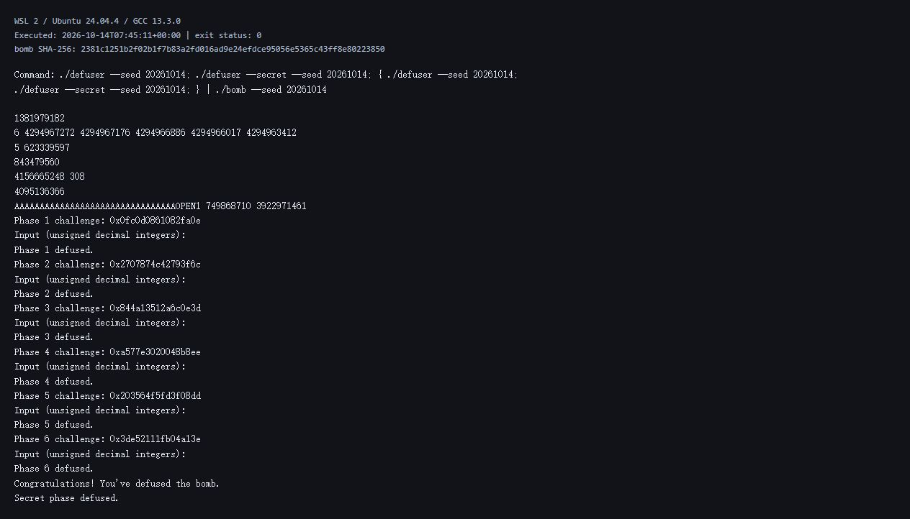

# Lab 2：BombLab 实验报告

姓名：卢伟　学号：23300130024

实验环境：WSL 2，Ubuntu 24.04.4，GCC 13.3.0，GDB 15.1。使用本人学号对应的炸弹，SHA-256 为 `2381c1251b2f02b1f7b83a2fd016ad9e24efdce95056e5365c43ff8e80223850`。

## 一、分析方法与运行结果

本次提交的是随 challenge 变化的求解函数。分析时先用 `objdump -d --no-show-raw-insn bomb` 查看各关和被调用函数，再用 GDB 读取跳转表、链表数据以及 Honor 的局部内存。实现只改 `defuser.c`；接口、驱动、测试、工作流和个人炸弹保持原样。

下文的 `C` 表示该关传入的 challenge。除明确标出的 64 位移位外，计算结果均按 `uint32_t` 保留低 32 位，右移是逻辑右移。这一点在第 2 关尤其明显：中间结果可以回绕成很大的无符号数。

公开测试的结果为六关 `60/60`、Honor `10/10`。另外选用不在公开列表中的 seed `20261014`，生成六行口令和 Honor 输入，再送入同一 seed 的炸弹：

```bash
./defuser --seed 20261014
./defuser --secret --seed 20261014
{ ./defuser --seed 20261014; ./defuser --secret --seed 20261014; } | ./bomb --seed 20261014
```

该 seed 的六关和 Honor 均通过。下面是实际命令输出的终端视图截图，包含对应的 challenge 和输入，作为各关在公开 seed 之外的验证记录。



| 关卡 | seed 20261014 的口令 | 结果 |
| --- | --- | --- |
| 第 1 关 | `1381979182` | Phase 1 defused |
| 第 2 关 | `6 4294967272 4294967176 4294966886 4294966017 4294963412` | Phase 2 defused |
| 第 3 关 | `5 623339597` | Phase 3 defused |
| 第 4 关 | `843479560` | Phase 4 defused |
| 第 5 关 | `4156665248 308` | Phase 5 defused |
| 第 6 关 | `4095136366` | Phase 6 defused |
| Honor | 32 个 `A`，接 `OPEN1 749868710 3922971461` | Secret phase defused |

## 二、第 1 关：函数调用与参数

`phase_01` 只读入一个整数，将它与 `p1_compute` 的返回值比较。`p1_compute` 分别取 challenge 的低 32 位、右移 32 位和右移 16 位的低 32 位，并调用三个小函数。关键指令如下：

```asm
# p1_step0
sub    %esi,%edi
lea    0x3e(%rdi,%rdi,4),%eax
# p1_step1
xor    $0x1e6c,%esi
lea    (%rsi,%rdi,4),%eax
# p1_step2
lea    (%rdi,%rsi,4),%eax
xor    $0xa2f6,%eax
```

按 System V 调用约定，前两个整数参数在 `edi`、`esi`，返回值在 `eax`。`lea` 在这里用于整数计算，不是读取内存。记 `a=low32(C)`、`b=low32(C>>32)`、`m=low32(C>>16)`，依照实际传参顺序得到：

```text
r0 = 5*(a-b) + 0x3e
r1 = 4*b + (m XOR 0x1e6c)
r2 = (r1 + 4*a) XOR 0xa2f6
口令 = r0 XOR r2
```

最后的异或来自 `p1_compute` 返回前的 `xor %ecx,%eax`。不能只计算最后一个 helper 的返回值。

## 三、第 2 关：数组递推

本关要求六个整数。栈上的数组元素通过 `-0x40(%rbp,%rdx,4)` 访问，每项占 4 字节；循环下标从 1 到 5。

```asm
shr    $0x19,%rdx
add    %edx,%edx
and    $0x1e,%edx
add    $0x4,%edx
...
lea    0x2(%rdx),%ecx
add    %edx,%eax
shr    %cl,%rsi
lea    (%rax,%rax,2),%eax
and    $0x3f,%esi
sub    %esi,%eax
```

第一段给出首项，后一段在每次循环中计算下一项：

```text
v[0] = 4 + 2*((C>>25) & 15)
v[i] = 3*(v[i-1]+i) - ((C>>(i+2)) & 63)，i=1..5
```

`lea (%rax,%rax,2)` 对应乘 3。种子 `20261014` 的首项为 6，第二项的数学结果为 -24，在 32 位无符号计算中变成 `4294967272`。解法使用 `uint32_t`，按汇编中的宽度继续递推。

## 四、第 3 关：跳转表

本关的第一个整数必须等于 `C & 7`。第二个整数来自 `p3_dispatch`，它的参数是 `x=low32(C>>3) XOR low32(C>>32)`。

```asm
cmp    $0x7,%eax
ja     <返回0的分支>
notrack jmp *0x405820(,%rax,8)
```

`0x405820` 是跳转表，每个表项占 8 字节。用 GDB 的 `x/8gx 0x405820` 读取后，再查看每个目标地址最终跳到哪个 `p3_case`，得到下表。表项顺序与函数名的编号不同。

| 下标 | 对应函数 | 第二个整数 |
| --- | --- | --- |
| 0 | `p3_case_1` | `5*x + 0x6cb` |
| 1 | `p3_case_5` | `5*x + 0xd730` |
| 2 | `p3_case_2` | `5*x + 0x36984` |
| 3 | `p3_case_3` | `(x XOR 0x68c9) + (x>>1)` |
| 4 | `p3_case_0` | `(2*x) XOR 0x4d2b` |
| 5 | `p3_case_4` | `5*x + 0x18b5f` |
| 6 | `p3_case_6` | `(x XOR 0x9f94) + (x>>2)` |
| 7 | `p3_case_7` | `(2*x) XOR 0x61f2` |

`solve_phase_3` 按表项下标写成 switch。验证 seed `20261014` 时下标为 5，走的是 `p3_case_4`。

## 五、第 4 关：递归与返回过程

调用 `p4_walk` 时，四个参数依次是：

```text
target = C & 127
low = 0
high = 127
bias = low32(C>>7) XOR low32(C>>32)
```

函数先计算 `mid=low+((high-low)>>1)`，再比较 target 和 mid。相等时直接返回 `(mid+0x6e) XOR bias`。左、右分支则先缩小区间并递归调用，返回后继续计算：

```asm
call   p4_walk
lea    (%rax,%rax,2),%eax
xor    %ebx,%eax
...
xor    $0x5,%eax      # 左分支
# 右分支最后异或 0x10
```

这里的 `ebx` 保存 `mid+bias`，因此若递归结果为 r：

```text
左侧返回值 = (3*r) XOR (mid+bias) XOR 5
右侧返回值 = (3*r) XOR (mid+bias) XOR 0x10
```

最终口令来自递归返回值，不是 target 或搜索经过的节点编号。target 只会落在 0–127，递归总能到达相等的基例，边界处也不会执行无效的 `mid-1` 分支。

## 六、第 5 关：结构体和链表

`p5_traverse` 从 `0x405b60` 的头指针表选起点。节点访问指令为：

```asm
mov    (%rdx),%rdx       # next
mov    0x8(%rdx),%esi    # value
xor    0xc(%rdx),%eax    # tag
add    %esi,%eax
```

由偏移可知一个节点由 8 字节 next 指针、4 字节 value、4 字节 tag 组成，大小为 16 字节。节点数组起点是 `0x405ba0`。将指针地址换成数组下标后，头表是 `{9,8,1,7,3,2,11,0}`，节点数据如下：

| 下标 | next 下标 | value | tag |
| --- | --- | --- | --- |
| 0 | 4 | `0x64a` | `0xe939` |
| 1 | 7 | `0x966` | `0x861d` |
| 2 | 11 | `0x242` | `0x1401` |
| 3 | 2 | `0x83b` | `0x3efe` |
| 4 | 6 | `0x134` | `0x48e0` |
| 5 | 10 | `0xa4d` | `0x86f5` |
| 6 | 5 | `0xb78` | `0xe54b` |
| 7 | 3 | `0x42a` | `0x912a` |
| 8 | 1 | `0x32d` | `0x2a7d` |
| 9 | 8 | `0x64` | `0x399f` |
| 10 | NULL | `0x506` | `0x9d61` |
| 11 | 0 | `0x773` | `0x4e32` |

起点由 `C&7` 决定，总共访问 `((C>>3)&3)+1` 个节点。虽然循环次数最多是 3，进入循环前已经处理了起点，所以最多访问 4 个节点。累积值初值为 `low32(C>>6) XOR low32(C>>32) XOR 0xf72f`，每访问一个节点执行 `(sum XOR tag)+value`。

口令的第一个数是最终 sum，第二个数是最后访问节点的 value。解法中的 next 用下标表示，不依赖炸弹加载到哪个地址；表中的常量是节点数据，不是某个 seed 的固定答案。

## 七、第 6 关：函数指针表

本关用函数指针表 `p6_ops` 完成两次间接调用。表地址是 `0x405e00`，关键指令为：

```asm
and    $0x7,%eax
call   *0x405e00(,%rax,8)
xor    $0xef9f,%eax
mov    %eax,%edi
call   *0x405e00(%rbx)
add    $0xd49a,%eax
```

第一次下标是 `C&7`。第二次下标是 `(C>>3)&7`；汇编把它保留成 `C&0x38`，直接当字节偏移使用。初始参数 x 为 `low32(C>>6) XOR low32(C>>32)`。读取表中的地址并分别反汇编后得到：

| 下标 | 变换 T(x) |
| --- | --- |
| 0 | `(x+0xe1d5) XOR (x>>3)` |
| 1 | `(x XOR 0x581a)+4*x` |
| 2、3 | `((x<<5)+0x9a0d) XOR (3*x)` |
| 4、7 | `ROL32(x,3) XOR 0xe606` |
| 5 | `(x XOR (x>>3))+0x4504` |
| 6 | `ROR32(x,2)` |

若两次下标为 i、j，口令就是 `T_j(T_i(x) XOR 0xef9f)+0xd49a`。`rol`、`ror` 的移出位需要从另一侧移回，不能直接换成普通左移或右移。

## 八、Honor：局部对象覆盖与上下文

Honor 的入口 `secret_gate` 先检查输入长度，再把字符串复制到一个局部对象中。关键的地址偏移和比较为：

```asm
lea    -0xd0(%rbp),%r12       # scratch 起点
call   secret_copy
cmpl   $0x4e45504f,-0xb0(%rbp)
lea    -0xac(%rbp),%rdi       # 三个整数的文本起点
call   secret_phase
```

从 scratch 到标记的距离是 `0x20`，即 32 字节；再往后 4 字节是整数文本。`0x4e45504f` 在小端内存中的四个字节是 `OPEN`。所以输入先放 32 个 `A`，接 `OPEN`，再接三个无符号十进制整数。长度检查要求整行在 36–163 字节之间，生成的输入符合这个范围。

进入 `secret_phase` 后，challenge 和前六关口令算出的 context 都参与校验。记：

```text
a = low32(C) XOR low32(C>>32)
b = low32(context) XOR low32(context>>32)
k = context & 3
v = ROR32(a XOR b,3) XOR 0xed8f
v = v XOR (k*0x5d59) XOR low32(context>>16)
w = v XOR (b+k+0xb0d6+(a>>3))
```

三个整数是 `k v w`。驱动已计算好 context 并传给 `solve_secret`，求解函数直接使用它，不自行替换上下文。

seed `20261014` 下，在 `secret_gate` 入口观察到 challenge 为 `0xf4ae5e4a758f780a`，context 为 `0x968daa3123b0a275`。在复制完成后的地址 `0x40276b` 设置断点，用 `x/wx $rbp-0xb0` 和 `x/s $rbp-0xac` 读取局部对象，结果是：

```text
标记：0x4e45504f
整数文本："1 749868710 3922971461"
继续运行：Secret phase defused.
```

调试过程中只读寄存器和内存，没有修改寄存器、检查条件或炸弹数据来绕过校验。

## 九、补充验证与资料

公开测试之外，再选取连续 seed、64 位随机 seed，以及二的幂及其相邻值，去掉公开列表中的值后共 1,693 个。每个 seed 都将生成的六行口令和 Honor 输入交给原炸弹检查，全部通过。覆盖情况为：第 3 关 8 个分支、第 4 关 128 个 target、第 5 关 32 种起点与长度组合、第 6 关 64 种调用组合。

另用 AddressSanitizer 和 UndefinedBehaviorSanitizer 检查七个求解函数，对缓冲区容量 0–256 共测试 143,920 次。容量不够时返回非零，容量足够时结果完整，没有发现越界或未定义行为。求解函数只计算和格式化输出，不读写文件、启动进程或访问网络。

参考资料：

- [课程实验说明](https://ics-26fall-fdu.github.io/labs/lab2-bomb-lab/)及模板中的 `README.md`、`teaching/README.md`。
- [GDB 手册](https://sourceware.org/gdb/current/onlinedocs/gdb.html/)：断点、寄存器与内存读取命令。

辅助工具使用情况：objdump 用于导出汇编，GDB 用于读取程序状态与静态表；Codex 用于辅助分析汇编、草拟求解代码及整理报告。报告中的寄存器、内存值和验证结果均来自实际运行。
